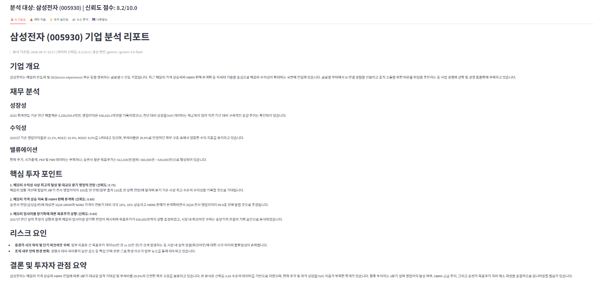

# AI Company Research Automation

**AI 기반 기업 리서치 자동화 파이프라인**

기업명을 입력하면 DART 공시·재무제표, 한국거래소 시세, 증권사 리포트(텔레그램 공개 채널·네이버 금융), 뉴스를 자동으로 수집하고,
Python으로 정리한 데이터를 LLM에 넘겨 **투자자 관점의 기업 분석 리포트**(Markdown / Excel / PDF / 웹 대시보드)를 만들어 줍니다.

## 파이프라인

```
기업명 입력 (예: 테크윙)
   │
   ▼
1. 수집 (collectors/)     DART · PyKRX · 텔레그램 · 네이버 금융 · 뉴스
   │                       (최근 3개월 리포트, 24시간 로컬 캐시, 재시도/rate limit)
   ▼
2. 처리 (processors/)     재무: 매출 성장률, 영업이익률, ROE/PER/PBR
   │                       텍스트: 키워드 추출, 긍정/부정 뉴스 분류
   ▼
3. 리서치 엔진 (research/) 출처 간 교차 비교 → 공통 투자포인트 + Confidence Score
   │
   ▼
4. LLM 리포트 (llm/)      정규화된 JSON → 투자자 관점 Markdown 리포트
   │                       (OpenAI 또는 Gemini, 키가 없으면 규칙 기반 fallback 리포트 생성)
   ▼
5. 출력 (output/, ui/)    Markdown · Excel · PDF · Streamlit 대시보드
```

## 폴더 구조

```
.
├── main.py                 # CLI 진입점
├── config/config.py        # pydantic-settings 기반 환경변수 로드
├── collectors/             # DART, KRX, 뉴스, 텔레그램, 네이버 금융 수집기
├── processors/             # 재무/텍스트 처리
├── models/                 # Pydantic 공통 스키마 (FinancialMetrics, NewsItem, ReportItem, ResearchResult)
├── research/               # 리서치 엔진 (투자포인트 추출, 신뢰도 점수)
├── llm/                    # 리포트 생성기와 프롬프트
├── output/                 # Markdown / Excel / PDF 내보내기
├── ui/streamlit_app.py     # 웹 대시보드
├── utils/                  # 기업명 매칭, 숫자 포맷터
├── SPEC.md                 # 상세 명세서
└── DEVELOPMENT_RULES.md    # 개발 규칙
```

모든 Collector는 원시 데이터가 아니라 정해진 Pydantic 모델을 반환합니다. 모듈별 반환 타입은 [SPEC.md](SPEC.md)에 정리되어 있습니다.

## 설치

Python 3.10 이상이 필요합니다.

```bash
pip install -r requirements.txt
cp .env.example .env    # 이후 .env에 본인 API 키 입력
```

### 환경변수 (`.env`)

| 변수 | 필수 | 설명 |
|---|---|---|
| `DART_API_KEY` | ✅ | [OpenDART](https://opendart.fss.or.kr/) 인증키 |
| `OPENAI_API_KEY` | | [OpenAI](https://platform.openai.com/api-keys) API 키 (LLM 리포트 생성) |
| `GEMINI_API_KEY` | | [Google AI Studio](https://aistudio.google.com/apikey) API 키 (LLM 리포트 생성) |
| `LLM_PROVIDER` | | `auto`(기본) / `openai` / `gemini`. `auto`는 OpenAI → Gemini 순으로 설정된 키를 사용 |
| `LLM_MODEL` | | 비우면 제공자별 기본 모델 (`gpt-4o` / `gemini-3.8-flash`) |
| `LLM_MAX_TOKENS` | | 응답 최대 토큰 (기본 8192). 추론 모델은 내부 추론 토큰도 이 한도를 함께 씀 |
| `LLM_REASONING_EFFORT` | | 추론 모델의 추론 강도 (`low` / `medium` / `high`). `gpt-4o` 등 비추론 모델이면 비워 둘 것 |
| `NAVER_CLIENT_ID` / `NAVER_CLIENT_SECRET` | | 네이버 뉴스 검색 API. 없으면 Google News RSS만 사용 |
| `TELEGRAM_API_ID` / `TELEGRAM_API_HASH` / `TELEGRAM_PHONE` | | [my.telegram.org](https://my.telegram.org/apps)에서 발급. 없으면 텔레그램 수집 생략 |
| `TELEGRAM_CHANNELS` | | 수집할 공개 채널 목록 (JSON 배열) |

LLM 키가 둘 다 없거나 `.env.example`의 예시 문구 그대로면 LLM 없이 수집 데이터로 fallback 리포트를 만듭니다. LLM 호출이 실패하면 원인(인증 실패, 모델 없음, 쿼터 소진 등)이 로그와 리포트 하단에 남습니다. 인증·권한·모델 오류처럼 다시 시도해도 같은 에러는 재시도하지 않고, 서버 오류(5xx)와 속도 제한만 재시도합니다.

나머지 설정값(수집 기간, 캐시 TTL 등)은 [.env.example](.env.example)을 참고하세요.

> `.env`, 텔레그램 세션 파일(`*.session`), 캐시, 생성된 리포트는 `.gitignore`로 저장소에서 제외됩니다.

## 사용법

```bash
# CLI
python main.py 삼성전자

# 웹 대시보드
streamlit run ui/streamlit_app.py
```

결과 리포트는 `output/reports/`에 `{기업명}_report_{시각}` 이름으로 저장됩니다.

## 대시보드

<!--
대시보드 스크린샷 추가 방법:
1. Streamlit 화면을 캡처해 docs/images/dashboard.png 로 저장
2. 아래 줄의 주석 표시를 지우고 커밋

-->

`streamlit run ui/streamlit_app.py`로 실행합니다. 사이드바에 기업명을 입력하면 재무 지표, 증권사 컨센서스, 핵심 투자포인트·리스크, 뉴스 감성 요약을 탭으로 보여 주고, 리포트 파일(Markdown / Excel / PDF)을 내려받을 수 있습니다.

## 샘플 리포트

아래는 `python main.py 삼성전자`로 2026-09-27에 실제 생성한 리포트입니다 (LLM: Gemini `gemini-3.8-flash`). 원본 파일은 [docs/sample_report_samsung_electronics.md](docs/sample_report_samsung_electronics.md)에 있습니다.

<details>
<summary><b>삼성전자 (005930) 기업 분석 리포트 — 펼쳐 보기</b></summary>

> 분석 기준일: 2026-09-27 22:54 | 데이터 신뢰도: 8.2/10.0 | 생성 엔진: gemini / gemini-3.8-flash

#### 기업 개요
삼성전자는 메모리 반도체 및 DX(Device eXperience) 등의 사업을 영위하는 글로벌 IT 기업입니다. 최근 멕시코 K-박람회에서 AI 연결 경험을 선보이는 등 글로벌 현장 마케팅과 함께 조직 내 타운홀 미팅을 추진하며 사업 경쟁력을 점검하고 있습니다. 2025 회계연도 기준 333조 6,059.4억원의 매출액과 43조 6,010.5억원의 영업이익을 기록하였으며, HBM4 등 차세대 메모리 공급을 준비하고 있습니다.

#### 재무 분석
##### 성장성
2025 회계연도 매출액은 333조 6,059.4억원, 영업이익은 43조 6,010.5억원을 기록하였으나, 전년 대비(YoY) 매출 성장률 데이터는 제공되지 않았습니다.
##### 수익성
2025 회계연도 기준 영업이익률은 13.1%, ROE는 10.4%, ROA는 8.0%를 나타냈으며 부채비율은 29.9%로 안정적인 수준을 유지하고 있습니다.
##### 밸류에이션
PER, PBR 및 시가총액 데이터는 부재하며, 증권사 평균 목표주가는 612,500원(범위: 560,000원 ~ 630,000원)으로 집계되었습니다.

#### 핵심 투자 포인트
**1. 3분기 실적 호조 및 메모리 수익성 개선 기대 (신뢰도: 0.75)**  
언론 보도에 따르면 3분기 전사 영업이익이 100조 원에서 110조 원을 상회할 것이라는 전망이 제기되며 메모리 부문의 수익성이 사상 최고 수준에 이를 것으로 기대되고 있습니다.

**2. HBM4 본격화 및 DRAM·NAND 판가 상승 전망 (신뢰도: 0.60)**  
삼성증권 리포트에 따르면 3Q26 영업이익은 99.8조 원으로 추정되며, HBM4 판매 본격화 및 지속적인 메모리 가격 상승세에 힘입어 전분기 대비 DRAM 판가는 18%, NAND 판가는 16% 상승할 것으로 전망되었습니다.

**3. 메모리 업사이클 장기화와 2027년 실적 추정치 상향 (신뢰도: 0.60)**  
증권사 분석을 통해 메모리 업사이클 장기화 관점이 제시되었으며, 2027년 연간 실적 추정치 상향에 따라 목표주가가 기존 53만 원에서 63만 원으로 상향 조정되었습니다.

#### 리스크 요인
- 증권가 내 목표주가 괴리(63만 원 vs 35만 원)가 발생하고 피크아웃 우려에 따른 주가 조정 가능성이 제기되는 등 시장 전망의 불확실성이 존재합니다.
- 고액자산가의 대규모 매수 및 타 대형주 급락 등 시장 변동성이 상존하며, 업계 내 육아휴직 감소와 같은 인력 및 근무 여건 관련 이슈가 뉴스에 보도되었습니다.

#### 결론 및 투자자 관점 요약
삼성전자는 견조한 재무구조(부채비율 29.9%, 영업이익률 13.1%)와 메모리 판가 상승 및 HBM4 본격화에 따른 대규모 영업이익 달성 기대감이 공존하고 있습니다. 다만 증권사 간 상이한 목표주가와 피크아웃에 대한 우려가 상존하므로, 향후 분기별 실제 실적 달성 여부와 HBM4 공급 추이를 지속적으로 모니터링할 필요가 있습니다. 본 리포트에 활용된 전체 데이터 신뢰도는 0.82 / 1.00 수준입니다.

</details>

## 주의사항

- 크롤링은 각 서비스 약관과 robots.txt 범위 안에서 개인 분석용으로만 사용합니다.
- 생성된 리포트는 참고 자료이며 투자 권유가 아닙니다.
