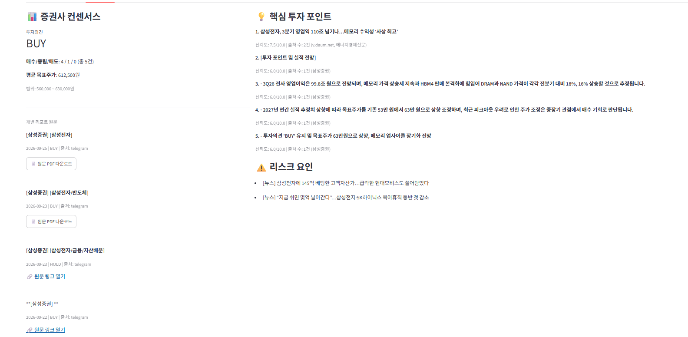
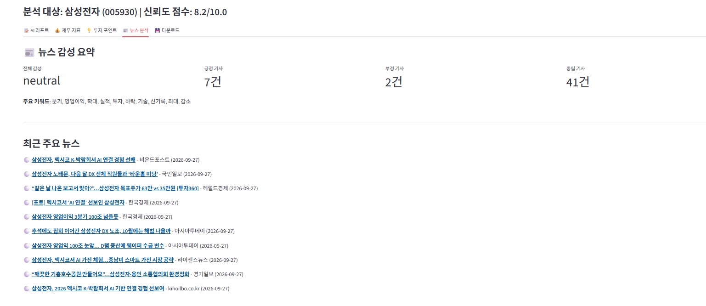

# AI Company Research Automation

**AI 기반 기업 리서치 자동화 파이프라인**

기업명을 입력하면 DART 공시·재무제표, 한국거래소 시세, 증권사 리포트(텔레그램 공개 채널·네이버 금융), 뉴스를 자동으로 수집하고,
Python으로 정리한 데이터를 LLM에 넘겨 **투자자 관점의 기업 분석 리포트**(Markdown / Excel / PDF / 웹 대시보드)를 만들어 줍니다.

## 파이프라인

```
기업명 입력 (예: 테크윙)
   │
   ▼
1. 수집 (collectors/)     DART · PyKRX · 텔레그램 · 네이버 금융 · 뉴스
   │                       (최근 3개월 리포트, 24시간 로컬 캐시, 재시도/rate limit)
   ▼
2. 처리 (processors/)     재무: 매출 성장률, 영업이익률, ROE/PER/PBR
   │                       텍스트: 키워드 추출, 긍정/부정 뉴스 분류
   ▼
3. 리서치 엔진 (research/) 출처 간 교차 비교 → 공통 투자포인트 + Confidence Score
   │
   ▼
4. LLM 리포트 (llm/)      정규화된 JSON → 투자자 관점 Markdown 리포트
   │                       (OpenAI 또는 Gemini, 키가 없으면 규칙 기반 fallback 리포트 생성)
   ▼
5. 출력 (output/, ui/)    Markdown · Excel · PDF · Streamlit 대시보드
```

## 폴더 구조

```
.
├── main.py                 # CLI 진입점
├── config/config.py        # pydantic-settings 기반 환경변수 로드
├── collectors/             # DART, KRX, 뉴스, 텔레그램, 네이버 금융 수집기
├── processors/             # 재무/텍스트 처리
├── models/                 # Pydantic 공통 스키마 (FinancialMetrics, NewsItem, ReportItem, ResearchResult)
├── research/               # 리서치 엔진 (투자포인트 추출, 신뢰도 점수)
├── llm/                    # 리포트 생성기와 프롬프트
├── output/                 # Markdown / Excel / PDF 내보내기
├── ui/streamlit_app.py     # 웹 대시보드
├── utils/                  # 기업명 매칭, 숫자 포맷터
├── SPEC.md                 # 상세 명세서
└── DEVELOPMENT_RULES.md    # 개발 규칙
```

모든 Collector는 원시 데이터가 아니라 정해진 Pydantic 모델을 반환합니다. 모듈별 반환 타입은 [SPEC.md](SPEC.md)에 정리되어 있습니다.

## 설치

Python 3.10 이상이 필요합니다.

```bash
pip install -r requirements.txt
cp .env.example .env    # 이후 .env에 본인 API 키 입력
```

### 환경변수 (`.env`)

| 변수 | 필수 | 설명 |
|---|---|---|
| `DART_API_KEY` | ✅ | [OpenDART](https://opendart.fss.or.kr/) 인증키 |
| `OPENAI_API_KEY` | | [OpenAI](https://platform.openai.com/api-keys) API 키 (LLM 리포트 생성) |
| `GEMINI_API_KEY` | | [Google AI Studio](https://aistudio.google.com/apikey) API 키 (LLM 리포트 생성) |
| `LLM_PROVIDER` | | `auto`(기본) / `openai` / `gemini`. `auto`는 OpenAI → Gemini 순으로 설정된 키를 사용 |
| `LLM_MODEL` | | 비우면 제공자별 기본 모델 (`gpt-4o` / `gemini-3.8-flash`) |
| `LLM_MAX_TOKENS` | | 응답 최대 토큰 (기본 8192). 추론 모델은 내부 추론 토큰도 이 한도를 함께 씀 |
| `LLM_REASONING_EFFORT` | | 추론 모델의 추론 강도 (`low` / `medium` / `high`). `gpt-4o` 등 비추론 모델이면 비워 둘 것 |
| `NAVER_CLIENT_ID` / `NAVER_CLIENT_SECRET` | | 네이버 뉴스 검색 API. 없으면 Google News RSS만 사용 |
| `TELEGRAM_API_ID` / `TELEGRAM_API_HASH` / `TELEGRAM_PHONE` | | [my.telegram.org](https://my.telegram.org/apps)에서 발급. 없으면 텔레그램 수집 생략 |
| `TELEGRAM_CHANNELS` | | 수집할 공개 채널 목록 (JSON 배열) |
| `KRX_ID` / `KRX_PW` | | [KRX 데이터 포털](https://data.krx.co.kr) 계정 (pykrx 1.2.8+에서 펀더멘털 조회에 필요). 없으면 PER·PBR·시가총액을 네이버 금융에서 보충 |

LLM 키가 둘 다 없거나 `.env.example`의 예시 문구 그대로면 LLM 없이 수집 데이터로 fallback 리포트를 만듭니다. LLM 호출이 실패하면 원인(인증 실패, 모델 없음, 쿼터 소진 등)이 로그와 리포트 하단에 남습니다. 인증·권한·모델 오류처럼 다시 시도해도 같은 에러는 재시도하지 않고, 서버 오류(5xx)와 속도 제한만 재시도합니다.

나머지 설정값(수집 기간, 캐시 TTL 등)은 [.env.example](.env.example)을 참고하세요.

> `.env`, 텔레그램 세션 파일(`*.session`), 캐시, 생성된 리포트는 `.gitignore`로 저장소에서 제외됩니다.

## 사용법

```bash
# CLI
python main.py 삼성전자

# 웹 대시보드
streamlit run ui/streamlit_app.py
```

결과 리포트는 `output/reports/`에 `{기업명}_report_{시각}` 이름으로 저장됩니다.

## 대시보드


`streamlit run ui/streamlit_app.py`로 실행합니다. 사이드바에 기업명을 입력하면 재무 지표, 증권사 컨센서스, 핵심 투자포인트·리스크, 뉴스 감성 요약을 탭으로 보여 주고, 리포트 파일(Markdown / Excel / PDF)을 내려받을 수 있습니다.

| 투자 포인트 탭 | 뉴스 분석 탭 |
|---|---|
|  |  |

## 샘플 리포트

아래는 `python main.py 삼성전자`로 2026-09-27에 실제 생성한 리포트입니다 (LLM: Gemini `gemini-3.8-flash`). 원본 파일은 [docs/sample_report_samsung_electronics.md](docs/sample_report_samsung_electronics.md)에 있습니다.

<details>
<summary><b>삼성전자 (005930) 기업 분석 리포트 — 펼쳐 보기</b></summary>

> 분석 기준일: 2026-09-27 23:11 | 데이터 신뢰도: 8.2/10.0 | 생성 엔진: gemini / gemini-3.8-flash

#### 기업 개요
삼성전자는 글로벌 반도체, 스마트폰, 디스플레이, 가전 사업 등을 영위하는 종합 IT 기업입니다. 2025 회계연도 기준 연간 매출액 333조 6,059억원, 영업이익 43조 6,011억원을 기록하며 견조한 실적을 유지하고 있습니다. 최근에는 메모리 가격 상승세와 HBM4 등 고부가 제품 판매 확대에 힘입어 분기 실적 개선 및 메모리 업사이클 장기화 국면에 진입하고 있습니다.

#### 재무 분석
##### 성장성
2025년 연간 매출액은 전년 대비 10.9% 증가한 333조 6,059억원, 영업이익은 33.2% 증가한 43조 6,011억원을 기록하며 두 자릿수 성장세를 나타냈습니다.

##### 수익성
2025년 영업이익률은 13.1%를 달성했으며, ROE는 10.4%, ROA는 8.0%를 기록하며 양호한 자본 효율성과 수익성을 보이고 있습니다.

##### 밸류에이션
현재 주가는 286,500원(시가총액 1,674조 9,588억원)으로 PER은 12.85배, PBR은 3.33배 수준입니다. 집계된 증권사 1곳 기준 평균 목표주가는 630,000원으로 현재가 대비 높은 수준이나, 컨센서스가 1개 증권사 리포트만을 기반으로 산출된 점을 감안할 필요가 있습니다.

#### 핵심 투자 포인트
**1. 3분기 분기 실적 대폭 확대 및 메모리 수익성 개선 (신뢰도: 7.5/10.0)**  
메모리 반도체 업황 호조에 따라 3분기 영업이익이 100조 원 안팎에 이를 것이라는 전망이 제기되며 사상 최고 수준의 수익성 달성 가능성이 부각되고 있습니다.

**2. 메모리 가격 상승 지속 및 HBM4 본격화 (신뢰도: 6.0/10.0)**  
삼성증권은 3Q26 DRAM과 NAND 가격이 전분기 대비 각각 18%, 16% 상승할 것으로 추정했으며, HBM4 판매 본격화가 전사 실적 성장을 견인할 것으로 분석했습니다.

**3. 메모리 업사이클 장기화에 따른 실적 추정치 상향 (신뢰도: 6.0/10.0)**  
삼성증권은 2027년 연간 실적 추정치 상향을 바탕으로 메모리 업황 상승 국면이 장기화될 것으로 전망하며 목표주가를 630,000원으로 제시했습니다.

#### 리스크 요인
- **D램 증산에 따른 원재료(웨이퍼) 수급 변수**: 업황 호조에 맞춘 D램 증산 과정에서 웨이퍼 공급망 차질 발생 여부가 향후 실적 변동성을 키울 수 있습니다.
- **업황 피크아웃 우려에 따른 주가 변동성**: 메모리 사이클의 정점 통과(피크아웃)에 대한 시장의 시각 차이와 우려가 주가 변동 요인으로 작용할 수 있습니다.

#### 결론 및 투자자 관점 요약
삼성전자는 메모리 반도체 가격 상승과 차세대 HBM 공급 본격화에 따른 강력한 실적 개선 흐름을 맞이하고 있습니다. 다만, 본 분석의 컨센서스는 1개 증권사 리포트만을 기준으로 집계되었고 전체 데이터 신뢰도는 8.2/10.0입니다. 투자자는 향후 3분기 잠정 실적의 실제 부합 여부와 함께 웨이퍼 등 주요 원재료 수급 상황, 시장 내 메모리 사이클 지속성에 대한 평가를 면밀히 모니터링할 필요가 있습니다.

</details>

## 주의사항

- 크롤링은 각 서비스 약관과 robots.txt 범위 안에서 개인 분석용으로만 사용합니다.
- 생성된 리포트는 참고 자료이며 투자 권유가 아닙니다.
